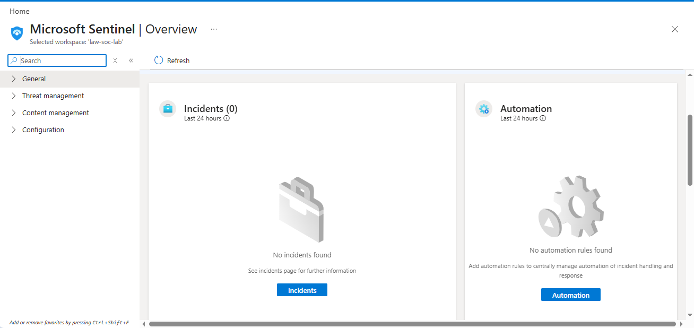
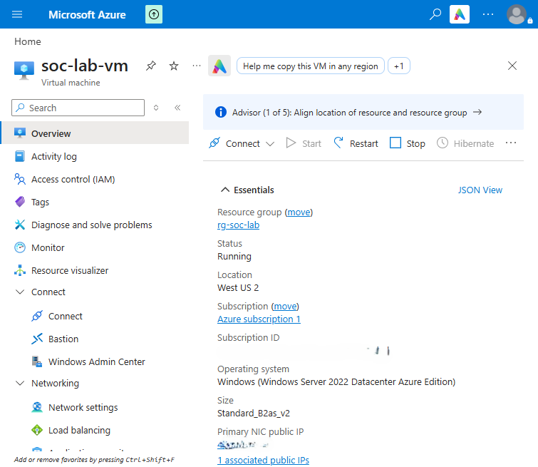
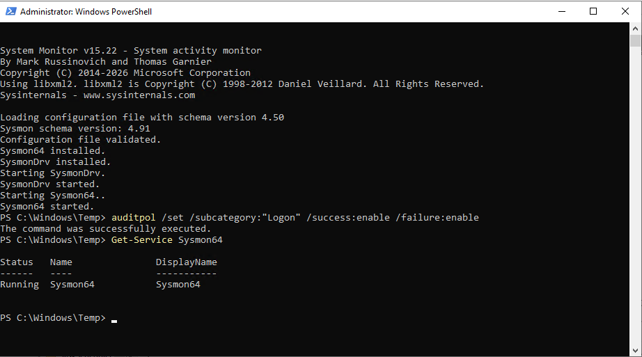
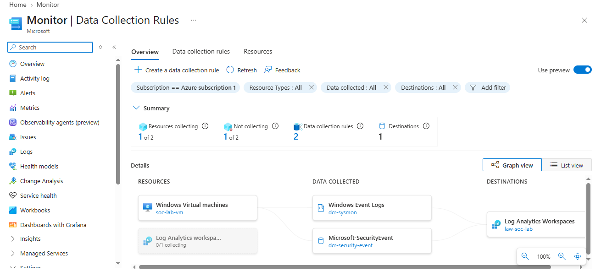
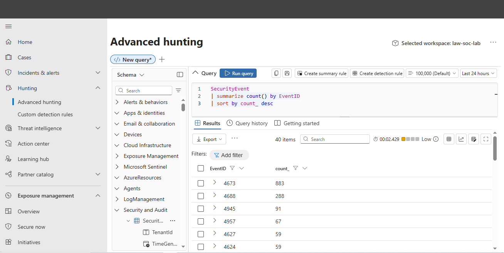
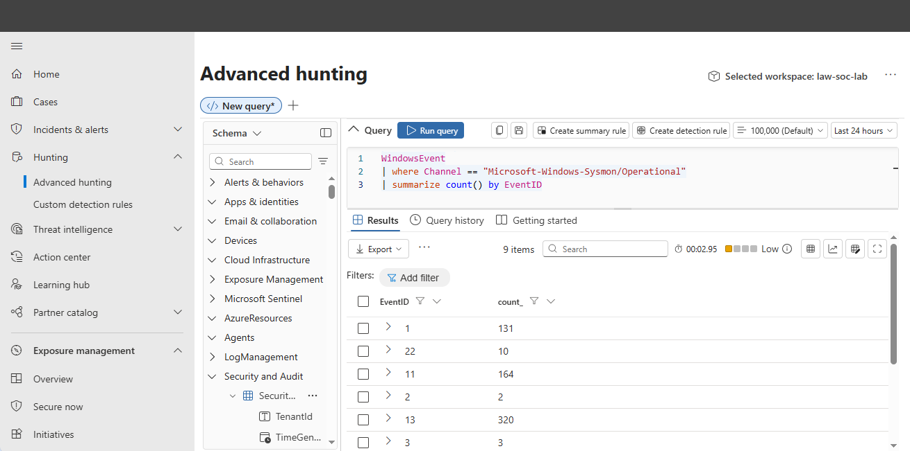
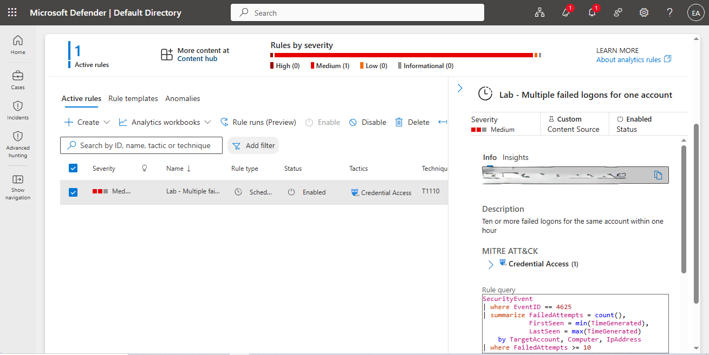
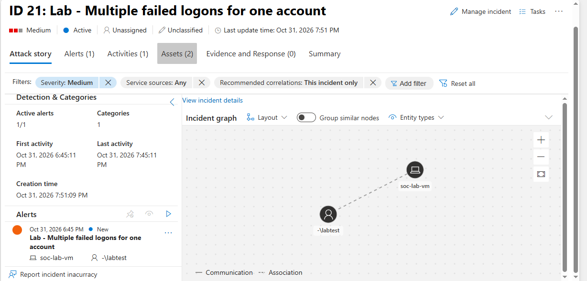
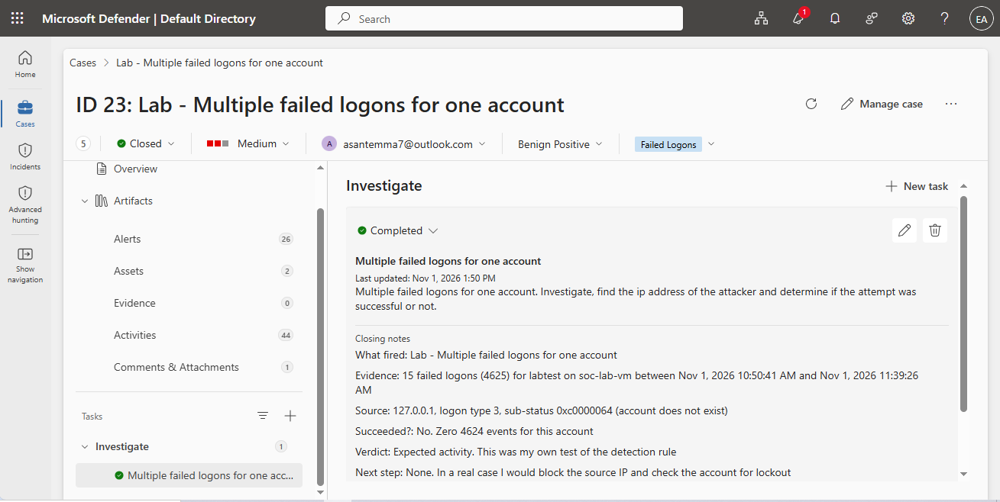

# Microsoft Sentinel SOC Home Lab

A home SOC lab built in Microsoft Azure. I deployed Microsoft Sentinel, connected a Windows virtual machine to it, wrote a detection rule for repeated failed logons, and investigated the incident it raised.

> Lab environment. All activity shown here was generated by me in my own Azure subscription for learning purposes.

## What I built

| Component | Detail |
|---|---|
| SIEM | Microsoft Sentinel on a Log Analytics workspace |
| Endpoint | Windows Server 2022 virtual machine |
| Endpoint logging | Sysmon with the SwiftOnSecurity configuration |
| Log sources | Windows Security events and Sysmon, collected by the Azure Monitor Agent through two data collection rules |
| Detection | A scheduled analytics rule for repeated failed logons, mapped to MITRE ATT&CK T1110 (Brute Force) |

## How it fits together

1. The VM generates Windows Security events and Sysmon events.
2. The Azure Monitor Agent sends them to the Log Analytics workspace, controlled by two data collection rules.
3. Sentinel analyses the logs. My analytics rule runs every five minutes and raises an incident when its conditions are met.

## Build

**Sentinel workspace**



**Virtual machine with Sysmon**




**Data collection rules**



## Verifying log ingestion

Windows Security events arriving in Sentinel:

```kql
SecurityEvent
| summarize count() by EventID
| sort by count_ desc
```



Sysmon events arriving in Sentinel:

```kql
WindowsEvent
| where Channel == "Microsoft-Windows-Sysmon/Operational"
| summarize count() by EventID
```



## Detection rule

**Name:** Lab - Multiple failed logons for one account

**Logic:** ten or more failed logons (Event ID 4625) for the same account within one hour

**Severity:** Medium

**MITRE ATT&CK:** Credential Access, T1110 Brute Force

**Schedule:** runs every 5 minutes, looks back 1 hour

```kql
SecurityEvent
| where EventID == 4625
| summarize FailedAttempts = count(),
            FirstSeen = min(TimeGenerated),
            LastSeen = max(TimeGenerated)
    by TargetAccount, Computer, IpAddress
| where FailedAttempts >= 10
```



## Testing the detection

I simulated a password-guessing attack on the VM by making 15 failed logon attempts for a test account. The rule raised an incident 16 minutes later.



## Investigation

| Question | Finding |
|---|---|
| What fired? | Lab - Multiple failed logons for one account |
| Evidence | 15 failed logons (4625) for labtest on soc-lab-vm between Nov 1, 2026 10:50:41 AM and Nov 1, 2026 11:39:26 AM |
| Source | 127.0.0.1, logon type 3, sub-status 0xc0000064, account does not exist |
| Did any attempt succeed? | No. Zero 4624 events for this account |
| Verdict | Expected activity. This was my own test of the detection rule |
| Classification | Informational, expected activity (security testing) |
| What I would do in a real case | Block the source IP, check the account for lockout, look for a successful logon after the failures |



## What I learned

- Logs don't appear in Microsoft Sentinel instantly. An endpoint agent like the Azure Monitor Agent (AMA) has to collect local Windows events first, buffer them, and stream them into Log Analytics before Sentinel can query them.
- Writing a good detection rule isn't just about the KQL query. You also have to enable alert grouping and incident creation settings so multiple firing events combine into one clean incident instead of spamming your queue.
- A quick spike of failed logins usually just means a user forgot their password or an automated script is trying random keys. But if you see a wave of failed logins followed by a successful login, that is a huge red flag for a successful password spray or brute-force attack that needs immediate containment.

## Tools

Microsoft Sentinel, Log Analytics, KQL, Azure Monitor Agent, Sysmon, Windows Server 2022, MITRE ATT&CK

## Queries

All the KQL I used is in [KQL_Queries.txt](KQL_Queries.txt).
